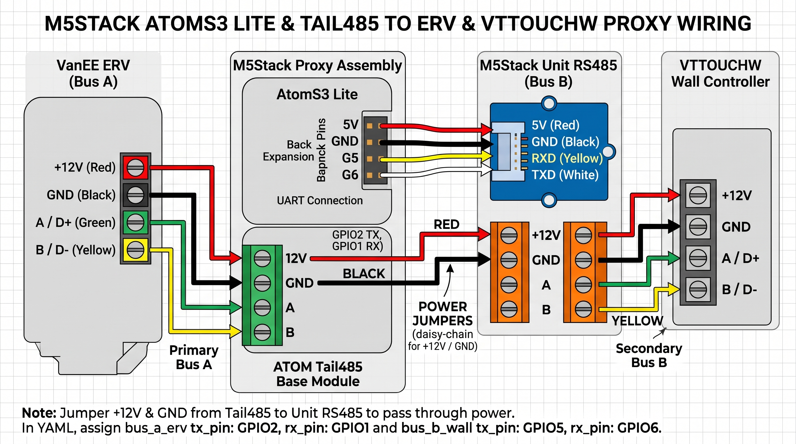

## Dual-Bus RS485 Proxy (VTTOUCHW to VanEE/Broan AI Series ERV)

This dual-bus proxy enables non-intrusive integration of your VanEE AI Series (or equivalent Broan) ERV with Home Assistant, while **fully preserving** your physical `VTTOUCHW` wall touchscreen controller. 

Because the `VTTOUCHW` and ERV rely on tight, latency-critical, token-based Master/Slave communication over RS485, tapping the bus passively or trying to inject writes will trigger collisions and communication faults (such as `E50` on the wall controller). 

This proxy solves this by acting as an inline "Active Bridge":
- **Bus A (ERV-facing):** The proxy emulates a Master/Slave controller to read from and write to the physical ERV.
- **Bus B (Wall Screen-facing):** The proxy emulates the ERV, instantly answering the `VTTOUCHW`’s intense, rapid polling requests.
- **Bridging:** Environmental readings and commands pass seamlessly between the two buses, while Home Assistant receives and injects sensor data and operations (like custom run timers, humidity targets, or speed toggles) asynchronously.

---

### Hardware Bill of Materials (BOM)

To build the inline proxy, you need the following standard M5Stack hardware:

| Item | Brand / Link | Purpose | GPIO Configuration |
| :--- | :--- | :--- | :--- |
| **M5Stack ATOM Lite / AtomS3 Lite** | [M5Stack](https://shop.m5stack.com/products/atoms3-lite-esp32-s3-development-kit) | ESP32-S3 microcontroller executing the proxy logic and hosting ESPHome. | Base for Tail485, Expansion header for Bus B |
| **ATOM Tail485 Base Module** | [M5Stack](https://shop.m5stack.com/products/atom-tail485) | High-reliability RS485 transceiver for Bus A (to ERV). Includes a DC-DC converter to power the stack. | `GPIO2` (TX), `GPIO1` (RX) |
| **M5Stack Unit RS485** | [M5Stack](https://shop.m5stack.com/products/rs485-unit) | Compact RS485 transceiver expansion module for Bus B (to VTTOUCHW). | `GPIO5` (TX via G5), `GPIO6` (RX via G6) |
| **4-Wire Grove Cable / Jumper Wires**| M5Stack | Connects the AtomS3 back header to the RS485 Unit. | Black (GND), Red (5V), Yellow (G5), White (G6) |

---

### Wiring Diagram

Refer to the wiring schematic below to interconnect your ERV, the dual-bus proxy assembly, and the VTTOUCHW wall controller. 

> [!CRITICAL]
> Remember to wire the `+12V` and `GND` power jumpers between the ATOM Tail485 (Bus A) and M5Stack Unit RS485 (Bus B) terminals. This acts as a daisy-chain, passing 12V power from the ERV directly through to boot the wall controller!



*   **Primary Bus A (from ERV):** Incoming Red (`+12V`), Black (`GND`), Green (`A / D+`), Yellow (`B / D-`) wires connect to the ATOM Tail485 base terminal block.
*   **Secondary Bus B (to VTTOUCHW):** Outgoing Red (`+12V`), Black (`GND`), Green (`A / D+`), Yellow (`B / D-`) wires connect from the M5Stack Unit RS485 screw terminal block to the Wall Controller's inputs.

---

### Understanding the 61 Seeding Register Cache

To keep the `VTTOUCHW` wall controller satisfied and prevent `E50` communication timeouts (~450 ms margin), the proxy initializes with **61 critical register "seeds"** directly in its flash-to-RAM cache. This precise number represents the exact operational footprint of your thermostat:

1. **The 41 Routine Operation Registers:** Repeatedly polled for real-time operation (fan speed `0x0020`, indoor RH% `0x0450`, indoor temp `0x0550`, live thermistor `0x01E0`, filters `0x0830`/`0x0930`, and basic state flags).
2. **The 2 Boot-Only Identification Registers:** `0x0100` (Hardware ID) and `0x0BF0` (Model Family String `"STD"`). Polled exactly once on power-cycle. Pre-seeding prevents "cold boot" misses, ensuring the controller recognizes the ERV immediately.
3. **The 18 Installer & Balancing Menu Registers:** Dedicated to deep telemetry (fan motors `0x0510`/`0x0610`, calibration indexes `0x1610`/`0x1710`, bounds `0x0422`/`0x0C50`, and event log wipes `0x1600`). Unlocks installer menus instantly without wait stalls.

#### What happens if you hit an unseeded menu?
If the wall screen queries an address outside the 61-seed baseline:
1. **Dynamic Holding:** Bus B identifies the cache-miss on a new key and halts response to the VTTOUCHW using `HOLD_FOR_CACHE_MISS`.
2. **Urgent Acquisition:** Bus A immediately moves the missed register to the top of the queue and fires an query to the physical ERV (takes ~25–60 ms).
3. **Resolution:** Upon ERV reply, Bus B updates `regs_` and replies to the screen. 
4. **Failure Safeguard:** If the ERV doesn't reply within 150 ms, the proxy drops the hold and issues a standard placeholder payload (`0x00`) to guarantee the Screen never freezes or faults out.

---

### Home Assistant Integration

Once you deploy the configuration, the proxy will present a tidy control interface in Home Assistant, grouping routine controls together and tucking administrative operations into correct device categories:

* **Environment & Airflow Sensors:** Live CFM readings, actual intake (outdoor) temperature, room temperature, and room humidity.
* **Maintenance & Lifespan:** An "ERV Filter Remaining" countdown.
* **Operational Control:** Easily toggle fan speeds, select operating modes (like "Turbo / Override"), adjust intermittent minutes per hour, and edit relative humidity setpoints. 
* **Turbo / Override Duration:** An interactive slider supporting hours `1h`, `2h`, `3h`, or `4h` to directly match the wall screen overrides.
* **Maintenance Actions (Configuration Card):** A "Reset ERV Filter Timer" button.
* **Diagnostics (Diagnostic Card):** A "Dump Proxy Register Cache" trigger to save the runtime cache into memory logs (perfect for identifying and saving unmapped sub-menus to expand `seed_defaults_()`).

---

### Configuration Example

Save your custom firmware as `vanee_v150h75ns_vttouchw_proxy.yaml`. Add the dual-bus components and name/pin assignments:

```yaml
external_components:
  - source:
      type: git
      url: https://github.com/mahmoudhamadeh/broan_erv_uart
      ref: vttouchw-dual-bus-proxy
    components: [ broan_erv_proxy ]

# Dual-Bus UART setup
uart:
  - id: bus_a_erv
    tx_pin: GPIO2   # UART TX (Tail485 to ERV)
    rx_pin: GPIO1   # UART RX
    baud_rate: 38400
    stop_bits: 1
  - id: bus_b_wall
    tx_pin: GPIO5   # Back pin G5 (Unit RS485 to Screen)
    rx_pin: GPIO6   # Back pin G6
    baud_rate: 38400
    stop_bits: 1

broan_erv_proxy:
  id: erv_proxy
  uart_erv: bus_a_erv
  uart_wall: bus_b_wall

  # Airflows (High-priority Order)
  supply_cfm:
    name: "1. ERV Supply Airflow"
    icon: "mdi:fan-chevron-up"
  exhaust_cfm:
    name: "2. ERV Exhaust Airflow"
    icon: "mdi:fan-chevron-down"

  # Intake Thermistor
  erv_temperature:
    name: "3. ERV Intake Temperature"
    icon: "mdi:thermometer-chevron-down"

  # VTTOUCHW Wall Screen readings
  wall_temperature:
    name: "4. VTTOUCHW Room Temperature"
    icon: "mdi:home-thermometer-outline"
  wall_humidity:
    name: "5. VTTOUCHW Room Humidity"
    icon: "mdi:water-percent"

  # Maintenance
  filter_remaining_days:
    name: "6. ERV Filter Remaining"
    icon: "mdi:air-filter"
	

# Broan ERV serial component

An ESP32 component to communicate with Broan, Nutone, Venmar, and VanEE ERVs via their rs485 interface.

The protocol is documented [here](https://spitko.net/2025/08/08/Reverse-Engineering-an-ERV/)

Currently this project is stable, but may be missing some advanced features from certain models. If there is a feature you'd like added, please open an issue. We may need packet capture from a unit with this functionality.

<table>
  <tr>
    <td>
      
    </td>
    <td valign="top">
      
    </td>
  </tr>
</table>

## Supported models
We currently don't have a good range of what does and don't work, but it's currently believed that all Broan, Nutone, and VanEE ERVs that have rs485 inputs probably work. The easiest way to check is to see if your unit supports the VTTOUCHW (All three brands have a version of this interface, they are all presumed to be the same)

HRVs have been reported to work as well, but tend to support fewer features. You can safely remove sensors from the yaml that your device does not support.

## Requirements
1) You will need an esphome device that can communicate over rs485. Some devices come with this out of the box (waveshare esp32-s3-relay-6ch), or you can just buy an external tranceiver and wire it to the uart of your choice. Note that the waveshare device listed earlier is much easier to use than most, as it has automatic flow control and can be powered directly from the 12v output on your ERV. If you use a different device and make a working, stable configuration, please open an issue so we can start building a list with configuration files.
2) This library does not coexist with other serial wall remotes. This is a software limitation on the ERV itself, it will only ever respond to one device on the bus. It's theoretically possible to MITM a remote but that's outside the scope of this component.
3) You will ideally want to power this directly from the 12v output on the erv itself. this isn't a hard requirement, but it simplifies things a lot. If the ERV completes the handshake with the esp32 and it later goes away, the ERV will eventually drop into an error state and shut down, so it's just one less point of failure.

## Installation
Near the control interface on the ERV, look for a green terminal block that has D+, D-, and GND on it (typically a 6 terminal block that includes 12V, LED, and OVR). Connect the D+, D-, and GND connectors to your RS485 tranceiver. Ideally you can also use the +12v but very few ESP32s are set up to handle input voltages above 5V to check with your spec sheet first. If not, just use a USB cable and wall charger. If you go this route, you may need to additionally run a wire from the GND terminal on the ERV to the GND pin on the esp32, but this will depend on how your rs485 tranceiver is set up. Only do this if you're getting unexplained communication errors or crashes.

Some rs485 trancevers have a jumper for the terminating resistor, some do not. In my case I found I did not need a termination resister, but you may need one. Try enabling this, or adding a resistor manually across the terminals on the ESP32 side, if you have communication issues. You'll know if you flip these because you'll see a bunch of spew about alignment errors and unknown commands.

Also be aware some RS485 devices will label their pins A and B instead of D+ and D-. Somewhat confusingly, A is D- and B is D+

## Supported features
* Setting fan mode (Standby, Min, Max, Intermittent, Turbo, Override, and Med, which is treated as manual control)
* Setting fan speed in manual mode
* Humidity control mode
* Intake temperature
* Filter life left
* Fan CFM 

More features will be added as time allows. I've documented many fields that aren't supported yet. If there's a specific feature you want prioritized, open an issue. This project is at a point where it "works for me" so I don't have a lot of guiding light on what else should be added without external input.

## Humidity Control Mode
In Humidity Control Mode, the controller sets a target humidity level and the ERV automatically runs if the humidity is above this level. The ERV does not have a humidity sensor - the current humidity reading is sent periodically from the controller.  Since we are replacing the original controller, we need to send current humidity readings from the ESP device. This can be done from a lambda in your ESPHome config calling the setCurrentHumidity() function.  For an example configuration, see the [humidity_control_sample.yaml](./examples/humidity_control_example.yaml) configuration in the [examples](./examples/) directory.

To use humidity control mode once it is enabled, set the desired humidity with "Humidity Setpoint", and then turn on the Humidity Control switch.

## FAQ
Q: I see errors about failed communication

A: This could be a lot of things.
- If you're getting timeouts, it's probably the yaml being misconfigured. A lot of rs485 devices want a flow control pin, which needs to be specified (check your device's datasheet)
- If you see it getting data but complaining about alignment and unknown commands, it's likely either you swapped the +/- wires, or the communication is very weak. Double check that you wired up the ground wire correctly, and try adding or removing esp side termination.

Q: Why doesn't it support X?

A: Not everything is actually exposed via the rs485 interface. I may need dumps from a unit with the feature you're requesting, or it might already be mapped and just needs to be plumbed though to Home Assistant. Feel free to open an issue or PR

Q: What if I still want wall controls?

A: You can use the aux remotes, those use the dry contact interface which is a hard override. The fan mode will indicate "ovr" (override) when these controls are used. This is how Broan bypasses the protocol limitation. Alternatively, look at something like the Sonoff NSPanel and control the device via Home Assistant instead.

### ESPhome yaml
Add this to an existing config.
```
external_components:
  - source:
      type: git
      url: https://github.com/nspitko/broan_erv_uart
      ref: main
    components: [ broan ]

uart:
  id: rs485
  tx_pin: GPIO17 # Change these to match your rs485 tranceiver. 17/18 is txd1/rxd1
  rx_pin: GPIO18
  baud_rate: 38400
  rx_buffer_size: 2048
  #debug:
   # direction: BOTH
   # dummy_receiver: false
   # sequence:
   #   - lambda: UARTDebug::log_hex(direction, bytes, ' ');

broan:
  uart_id: rs485

select:
  - platform: broan
    fan_mode:
      name: "fan mode"

number:
  - platform: broan

    # Speed as a ratio of min vs max speed. Eg, if your MIN is 20 CFM and your MAX is 
    # 40 CFM, 50% means medium rill be at 30 CFM
    fan_speed:
      name: "fan speed"

    # How many seconds ON per hour in int mode (eg, a value of 20 means the ERV will run
    # 20 minutes on 40 minutes off every hour )
    intermittent_period:
      name: "Intermittent Period"

sensor:
  - platform: broan
    # As reported by the ERV, in watts
    power:
      name: Power draw

    # Intake air temperature. This will generally read high
    temperature:
      name: Temperature

    # In Days
    filter_life:
      name: Remaining Filter life

    # CFM values as reported by the ERV
    supply_fan_cfm:
      name: "Supply fan CFM"
    exhaust_fan_cfm:
      name: "Exhaust fan CFM"

    # Fan motor RPM values
    supply_fan_rpm:
      name: "Supply fan RPM"
    exhaust_fan_rpm:
      name: "Exhaust fan RPM"

    # Not all ERVs have these sensor, remove if you don't get readings from it.

    # Exhaust air temperature.
    temperature_out:
      name: Temperature Out


text_sensor:
  - platform: broan
    
    # If there is a major fault, it will be indicated here. Else "OK"
    fault_code:
      name: "Fault code"
    
    # Same as above, but for warnings.
    warning_code:
      name: "Warning code"

    # Active mode. Indicates what the fans are currently doing
    active_mode:
      name: "Active Mode"

    # Potentially useful for development
    #model: { name: "Model" }
    #firmware: { name: "Firmware" }
    #firmware_version: { name: "Firmware Version" }
    #hardware_revision: { name: "Hardware Rev" }


button:
  - platform: broan

    # Resets filter life to 7884000 seconds / 3 months (Default behavior)
    filter_reset:
      name: Filter reset

```
